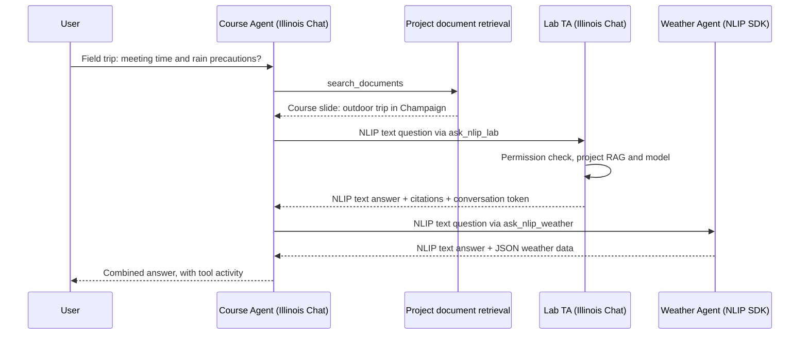

# Illinois Chat 的 NLIP Agent 集成

这次实现把一个 Illinois Chat project 作为拥有独立文档和模型配置的 Agent：
它可以通过 NLIP 向登记的远程 Agent 提问，也可以通过 NLIP 回答其他 Agent 的文档问题。
支持范围是官方 Python `nlip-sdk==0.1.3` / `nlip-server==0.1.3` 的 HTTP JSON 文本问答。
这是一版可运行的文本集成；多模态、控制消息、异步任务和协议认证协商需要后续扩展。

## 1. 现有产品机制与使用方法

一个 project 包含自己的名称、owner/admin、访问名单、文档集合、system prompt、模型/provider 配置和工具配置。
上传文件不会训练或微调一个模型：文件经过解析、切块、embedding 后进入检索库；回答时相关片段被放入 LLM 的 prompt。
因此“上传资料形成 custom Agent”可以理解为配置一个有专属知识库的 RAG assistant。

典型操作流程：

1. 登录后进入 `/new` 创建 project。
2. 在 `/<project>/dashboard` 上传 PDF/课件等资料，等待 ingest 完成。
3. 在项目设置中配置可用模型/provider、system prompt、示例问题、访问权限；可以选择文档优先、guided learning、citations 等设置。
4. 打开 `/<project>/chat`，选择模型，提出文档相关问题。文档组可限制检索范围。
5. 要使用多轮工具规划，在项目设置中打开 Agent Mode 功能，并在聊天中启用 Agent Mode。它会逐步展示检索、工具执行和最终回答。
6. 原有 `/<project>/tools` 可连接 Sim AI workspace，把已部署 workflow 转为可调用工具。本次在同一页面加入独立的 NLIP 配置区；NLIP 不要求配置 Sim workspace。

另外，聊天中临时附加的文件有单独的处理路径，带 `conversation_id`，与整个 project 的长期文档库有区别。
第一版 NLIP 入站查询只检索目标 project 的文档，不接受任意 UI conversation ID，不读取另一位用户的聊天附件或聊天历史。

## 2. 代码职责地图

以下路径均相对于仓库根目录。

| 模块 | 主要责任 | 关键代码 |
| --- | --- | --- |
| Next.js 页面及 UI | 创建项目、上传资料、配置模型/权限、聊天与执行记录 | `apps/frontend/src/pages/new.tsx`、`src/components/UIUC-Components/MakeNewCoursePageSteps/`、`src/components/UIUC-Components/LargeDropzone.tsx`、`src/components/Chat/Chat.tsx`（后面三项位于 `apps/frontend/`） |
| 项目管理 | 创建项目及保存 project metadata | `apps/frontend/src/utils/apiUtils.ts` 的 `createProject`；`apps/backend/ai_ta_backend/service/project_service.py` |
| 对话编排 | 接收 Agent 请求、逐步选工具/执行/最终生成、发 SSE 事件 | `apps/frontend/src/app/api/agent/route.ts`、`src/server/agent/runAgentConversation.ts`、`src/types/agentStream.ts` |
| 普通聊天和公共 API | 检查 API key/project 权限、检索上下文、执行工具、生成回答 | `apps/frontend/src/pages/api/chat-api/chat.ts`、`src/utils/streamProcessing.ts` |
| 工具适配 | 把工具转为模型的 function schema；发现及运行 Sim workflows | `apps/frontend/src/server/agent/agentServerUtils.ts`、`src/utils/functionCalling/handleFunctionCalling.ts`、`src/utils/server/toolRouting.ts` |
| Prompt 组合 | 合并 system prompt、文档证据、历史和工具结果，处理 token 预算 | `apps/frontend/src/app/utils/buildPromptUtils.ts` |
| 检索 | 按项目选择 pgvector 或 Qdrant；查询 embedding 并返回带文件/页码的 context | `apps/frontend/src/utils/fetchContexts.ts`、`src/server/fetchContextsForVectorSearch.ts`；`apps/backend/ai_ta_backend/service/retrieval_service.py` |
| 文件 ingest | 文件解析、切块、embedding、写向量库；RabbitMQ 排队和 worker | `apps/backend/ai_ta_backend/rabbitmq/worker.py`、`ingest.py`、`embeddings.py`、`vector_store.py` |
| 临时聊天文件 | 把聊天附件处理为 conversation 范围的上下文 | `apps/frontend/src/pages/api/UIUC-api/chat-file-upload.ts`；backend `main.py` 的 `/process-chat-file` |
| 网页抓取 | 抓取网页内容并送入 ingest | `apps/crawlee/src/` |
| 基础设施 | Postgres、Redis、S3/MinIO、Qdrant、RabbitMQ、Keycloak | `infra/docker/`、`infra/db/`、`infra/keycloak/` |

表中省略 `apps/frontend/` 前缀的 `src/...` 路径仍属于 frontend。
本项目的“Agent/LLM app”编排主要在 **Next.js 服务端**；Flask backend 的主要责任是文档处理、检索和相关服务。

## 3. 设计与实现位置



新增代码：

| 位置 | 作用 |
| --- | --- |
| `apps/frontend/src/types/nlip.ts` | 消息和配置 schema、文本/令牌提取、输入长度限制 |
| `apps/frontend/src/server/nlip/config.ts` | 项目级 Redis 配置、凭据加密、可信 origin 验证 |
| `apps/frontend/src/server/nlip/client.ts` | NLIP HTTP client；生成 `ask_nlip_<id>` 工具；超时/取消/大小限制 |
| `apps/frontend/src/server/nlip/answerProject.ts` | 入站文档问答，复用现有模型选择、检索、prompt builder 和模型路由 |
| `apps/frontend/src/pages/api/nlip/[course_name].ts` | 项目 NLIP 入站端点与 API key/项目授权 |
| `apps/frontend/src/pages/api/UIUC-api/tools/nlipAgents.ts` | 管理员读写 NLIP 配置，返回时隐藏凭据 |
| `apps/frontend/src/pages/api/UIUC-api/tools/nlipTools.ts` | 项目用户发现工具、手动/普通聊天执行 Agent 请求 |
| `apps/frontend/src/components/UIUC-Components/nlip/NlipAgentsPanel.tsx` | Tools 页面 NLIP 配置表单 |
| `apps/frontend/src/hooks/queries/useNlipConfig.ts` | 配置读取/保存与 React Query 缓存刷新 |

现有 `agentServerUtils.ts` 的发现/执行入口合并 Sim 和 NLIP 工具。
`handleFunctionCalling.ts` 同时接入浏览器的普通工具流程。
现有 `runAgentConversation.ts`、prompt builder 和 Agent timeline 接收相同的工具结果结构，继续负责规划与显示。
本次不增加 Node 依赖，不修改现有模型 provider 实现。

入站是一个**终止委派的文档问答 Agent**：它不再调用其他工具。
这样允许 A → B 的查询，同时避免 A → B → A 的循环。出站由现有 Agent loop 的步数上限及重复调用检测约束。

## 4. 接口约定

### 外部 Agent 查询 Illinois Chat

`POST /api/nlip/<project>`，`Content-Type: application/json`。
凭据为现有 Illinois Chat API key，HTTP `Authorization: Bearer ...` 或 NLIP `authorization` token 均可。
API key 所属用户必须是目标项目 owner/admin，与现有公共 chat API 的 edit 权限要求一致；public project 也不豁免。
还必须在 Tools 页面打开项目的 NLIP 入站开关；冻结的项目拒绝请求。
在 `/<project>/api` 管理 Illinois Chat API key。模型使用 Tools 指定的 model ID，或项目默认的可用服务端模型。

请求：

```json
{
  "format": "text",
  "subformat": "english",
  "content": "When and where do we meet for lab orientation?",
  "submessages": [
    { "format": "token", "subformat": "conversation", "content": "demo-turn-1" }
  ]
}
```

响应示例：

```json
{
  "format": "text",
  "subformat": "english",
  "content": "Orientation starts at 09:00 at the north entrance.",
  "submessages": [
    { "format": "token", "subformat": "conversation", "content": "demo-turn-1" },
    { "format": "structured", "subformat": "JSON", "label": "citations", "content": {
      "citations": [{ "index": 1, "filename": "lab-orientation.pdf", "page": "1", "url": "" }]
    } }
  ]
}
```

`conversation` token 在这里用于请求/响应关联，不代表服务端维护多轮会话状态。
未提供时响应创建一个 token；提供时原样返回。
问题可以由多个 text submessages 组成；不支持的 binary/control 等输入返回 422。
鉴权失败为 401，项目权限/开关为 403，项目不存在为 404，依赖或模型不可用为 503；响应内容使用 NLIP `error` 格式。
不把远程凭据或内部服务错误正文返回客户端。

### 项目配置与工具执行

| 方法与路径 | 用途 | 权限 |
| --- | --- | --- |
| `GET /api/UIUC-api/tools/nlipAgents?course_name=X` | 读取配置；token 只返回 `hasToken` | Keycloak 登录的 owner/admin |
| `POST /api/UIUC-api/tools/nlipAgents?course_name=X` | 保存整个 Agent 列表及入站设置 | Keycloak 登录的 owner/admin |
| `GET /api/UIUC-api/tools/nlipTools?course_name=X` | 获取启用的 `UIUCTool[]` | 已授权的项目用户 |
| `POST /api/UIUC-api/tools/nlipTools?course_name=X` | `{ "id": "weather", "question": "..." }` → ToolOutput | 已授权的项目用户 |

配置正文：

```json
{
  "inboundEnabled": false,
  "model": "",
  "agents": [{
    "id": "weather",
    "name": "Weather Agent",
    "description": "Ask for weather in Champaign and rain precautions.",
    "endpoint": "http://127.0.0.1:18081/nlip/",
    "enabled": true,
    "authMode": "bearer"
  }]
}
```

可选 `token` 保存远程 Agent 凭据：省略表示保留，`null` 清除，字符串替换。
改变 endpoint 或 authMode 时不会把旧 token 自动转移过去，需要重新提供。
`authMode` 可选 `bearer` 或 `nlip-token`。不得把凭据写进 URL。
工具参数只有 `question`；模型不能指定 URL、token 或目标 project。
执行时按调用者 project 重新查配置与 enabled 状态，阻止使用其他 project 的 Agent。

配置保存在 Redis hash `project_nlip_configs`，凭据由已有 server-only `ENCRYPTION_MASTER_KEY` 加密。
部署必须保留 Redis 持久化/备份和该 master key；轮换 key 后要重新输入已保存的凭据。
这里没有新增数据库 migration。未来若需要配置审计/事务，可以迁移到专用 Postgres 表。

## 5. 可复现 demo

在 frontend 目录执行：

```bash
cd apps/frontend # 从仓库根目录开始
bash scripts/nlip-demo/run.sh
```

脚本在 `apps/frontend/scripts/nlip-demo/.venv` 创建虚拟环境，安装固定版本的官方 SDK/server，运行两个集成测试，结束时停止它启动的服务。
有 `uv` 时使用 `uv`，否则使用 `python3 -m venv` 和 pip；无需 `/workspace` 目录。首次运行前在 frontend 执行 `npm ci`。
测试启动真实的 Python NLIP Weather Agent，以及绑定**生产 NLIP handler**的本地 HTTP harness。
然后运行生产 `runAgentConversation`、工具适配和 prompt builder。

它验证：

1. 课程 Agent 的 `search_documents` 返回课程片段。
2. 模型路由测试数据选择 `ask_nlip_lab`，通过 HTTP 查询 Illinois TA 的入站端点。
3. 入站复用 RAG adapter，把 TA 的文档片段放入 TA prompt。
4. `ask_nlip_weather` 通过 HTTP 查询官方 Python SDK/server 的 `/nlip/`。
5. 两个回复进入课程 Agent 的工具事件及最终 prompt。
6. 官方 Python `NLIP_Message` parser 接受 Illinois Chat 的返回消息及 correlation token。
7. 官方 SDK 返回 error 时，Illinois client 抛出失败，不构造成功答案。

结果写入系统临时目录的 `illinois-nlip-demo-result.json`（Linux 通常为 `/tmp/illinois-nlip-demo-result.json`），包括真实消息往返、工具事件和最终答案。示例答案：

> Meet at the north entrance at 09:00. The course trip is outdoors in Champaign.
> The demo weather agent predicts rain and 14 C; bring a raincoat.

**测试边界**：LLM 选工具/生成、文档检索、Redis 存储、API key 数据库查询使用显式 fixtures。
HTTP、官方 Python SDK/server、Illinois NLIP handler、RAG adapter、Agent loop 和 prompt builder 实际执行。
天气是固定测试天气。这个测试没有启动 Next.js 浏览器页面、Flask ingest worker，也没有调用真实模型或 embedding 服务。

## 6. 真实 PDF / 浏览器演示

先准备完整的应用基础设施，参照仓库 `DEV_SETUP.md`。
无需 Sim 时可用 `bash infra/scripts/start-dev.sh --create-schema --no-sim`；`--create-schema` 只用于空数据库的首次初始化。
配置实际的 chat model、支持工具调用的 router、embedding endpoint 及正确向量维度，并运行 backend、ingest worker 和 frontend。

生成可上传的两份 PDF：

```bash
cd apps/frontend # 从仓库根目录开始
python3 scripts/nlip-demo/create_pdfs.py
```

输出 `/tmp/illinois-nlip-demo-pdfs/course-slides.pdf` 和 `lab-orientation.pdf`。
创建 `course_slides` 和 `lab_ta` 两个项目，把对应 PDF 分别上传，并等 ingest 完成。
课程 PDF 只描述户外活动；集合时间/地点只在 TA PDF 中，天气只在远程 Agent 中。

启动 Weather Agent：

```bash
scripts/nlip-demo/.venv/bin/python scripts/nlip-demo/weather_agent.py --port 18081
```

本地直接运行 frontend 时，在 `apps/frontend/.env` 中设置：

```dotenv
NLIP_ALLOWED_ORIGINS=http://127.0.0.1:18081,http://127.0.0.1:3000
```

重启 frontend 后：

1. 在 `lab_ta/tools` 打开 NLIP 入站，指定可用 model ID，保存。使用该项目 owner/admin 的有效 Illinois Chat API key。
2. 在 `course_slides/tools` 登记 `lab`，endpoint 为 `http://127.0.0.1:3000/api/nlip/lab_ta`，把前一步 key 填入 token；登记 `weather`，endpoint 为 `http://127.0.0.1:18081/nlip/`。
3. 描述写清用途，例如 `lab` 知道 orientation time/location，`weather` 知道 Champaign forecast。保存后聊天工具列表会刷新。
4. 在 `course_slides` 项目打开 Agent Mode，问：`For the Champaign field trip, when and where should I meet, and should I bring a raincoat?`
5. 检查 timeline：应有文档检索、`Ask Lab TA (NLIP)` 和 `Ask Weather Agent (NLIP)`，以及包含三方信息的最终答案。

用真实模型时，工具选择取决于模型。验收必须同时检查实际工具事件及收到的 NLIP 请求，不能只看最终文本是否包含示例答案。
普通 chat 也支持 NLIP 工具；Agent Mode 更适合查看连续调用和委派过程。
请求只发送模型生成的聚焦问题，不自动发送整个上传文件或整个聊天历史；模型仍可能在问题中引用相关文档内容，因此只登记项目可以共享信息的目标。

Docker 模式在根 `.env` 配置 `NLIP_ALLOWED_ORIGINS`，Compose 已传给 frontend。
要使用 frontend 容器实际能访问的 hostname/origin；容器里的 `127.0.0.1` 指向容器自身。
云环境的 network allowlist 也要允许外部 Agent hostname，这与应用的 origin 限制是两层独立设置。

详细的本地启动、浏览器演示页和逐项验收步骤见 [本地 demo 操作指南](nlip-local-demo.md)。Weather Agent 的 `/demo` 页面可发送实时 NLIP HTTP 请求，并查看最近一次集成测试的 Agent loop 记录。该页面是独立协议演示控制台，不是完整 Illinois Chat 聊天页面。

## 7. 验证记录与后续工作

提交前运行 18 个相关测试文件，216 个测试全部通过，包含新增协议/配置/client/入站/权限/UI 测试、现有工具调用/Sim/Agent/RAG/prompt 回归测试，以及官方 SDK 的两个 HTTP 互通测试。此前还验证了项目创建、上传和公共聊天 API 的相关回归测试。
`npm run typecheck` 和新增代码的 ESLint 检查通过。实际运行的 Next.js 服务也编译了新增路由；无凭据查询入站及配置端点分别返回预期的 401 NLIP error 和 401 登录错误。
生成的两份 PDF 已通过 `pdftotext` 读取验证。

当前云环境没有完成真实 PDF ingest + 真实 LLM 的浏览器验收。
尝试拉取基础服务镜像时 Docker Hub 返回匿名拉取限流；前面的生产 build 还受 Google Fonts 网络访问限制。
需要可用的基础设施/镜像访问、chat/embedding 服务配置以及模型凭据，才能执行第 6 节的完整验收。
当前没有报告真实天气、真实模型推理或完整 NLIP 规范的一致性认证结果。

后续建议按需求扩展：按调用方限制项目文档组；专用 Agent 身份和更细的 API scopes；会话状态及多跳 trace/循环控制；协议能力发现与控制/多模态消息；部署级请求配额、审计与配置存储 migration。

协议参考：

- [NLIP 官方 SDK 消息定义](https://github.com/nlip-project/nlip_sdk/blob/main/nlip_sdk/nlip.py)
- [NLIP 官方 HTTP server](https://github.com/nlip-project/nlip_server/blob/main/nlip_server/routes/nlip.py)
- [NLIP 文档仓库](https://github.com/nlip-project/documents)
- [上游基于 MCP 的 Weather Agent 示例](https://github.com/nlip-project/nlip_soln/tree/main/nlip_soln/mcp)
