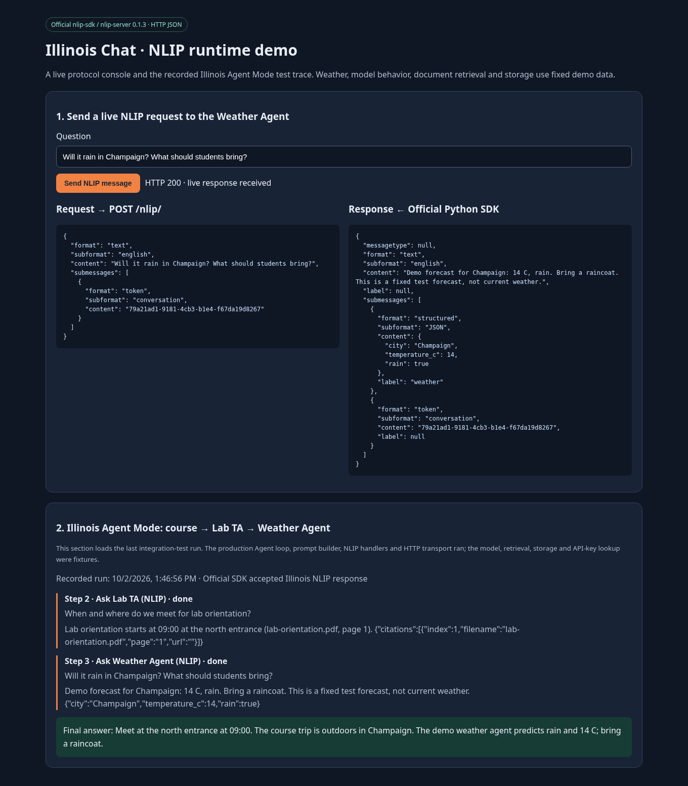
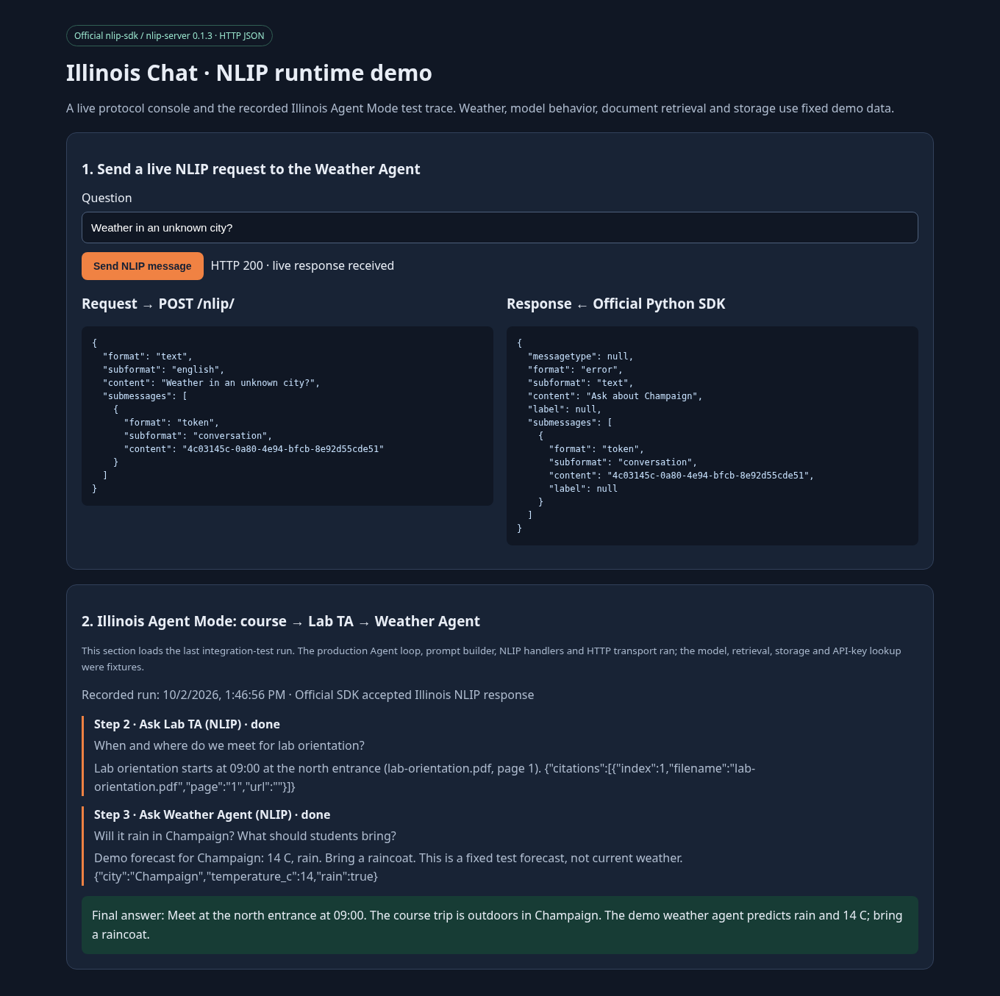

# 在本地运行 NLIP demo

有两种运行方式：独立的 NLIP 协议 demo 可直接运行，完整 Illinois Chat 的 PDF/Agent 聊天还需要应用基础设施和模型配置。
NLIP 修改位于 `river-li/Illinois-Chat` fork 的 `feat/nlip-agent-integration` 分支。

## 1. 获取这个版本

```bash
git clone --branch feat/nlip-agent-integration https://github.com/river-li/Illinois-Chat.git Illinois-Chat-nlip
cd Illinois-Chat-nlip
```

已有 checkout 可以先提交或暂存自己的修改，然后：

```bash
git fetch origin feat/nlip-agent-integration
git switch --track origin/feat/nlip-agent-integration
```

如果本地已经存在该分支，使用 `git switch feat/nlip-agent-integration`。
PR 的目标仓库是 `river-li/Illinois-Chat`，目标分支是 `main`；clone 远程 `main` 不会自动得到尚未合并的 NLIP 修改。

## 2. 最快的运行方式：协议 demo

要求 Node.js 22.12+、npm、Python 3.10+。下面的 Bash 命令适用于 Linux、macOS、Windows WSL。
`uv` 可选；没有 `uv` 时脚本会使用 Python venv 和 pip。

```bash
# 从仓库根目录开始
cd apps/frontend
npm ci
bash scripts/nlip-demo/run.sh
```

成功输出应有 `2 passed`，内容包括完整 Agent loop 互通及协议 error 处理。
脚本运行结束后测试服务会停止。它为后面的交互演示准备了 Python 虚拟环境和最近一次运行记录。

然后保持一个终端运行：

```bash
# 仍在 apps/frontend
scripts/nlip-demo/.venv/bin/python scripts/nlip-demo/weather_agent.py --port 18081
```

浏览器打开 `http://127.0.0.1:18081/demo`。
点击 **Send NLIP message**，应出现真实的 HTTP 200 回复，包含 `14 C, rain` 和与请求相同的 `conversation` token。
页面下半部显示刚才测试产生的 Illinois Agent Mode 记录：先询问 Lab TA，再询问 Weather Agent，最后组合回答。
页面清楚标记固定测试数据与真实运行的部分；它是协议控制台，完整 Illinois Chat 应用使用后面的部署步骤。

还可以直接请求 SDK 服务：

```bash
curl -fsS http://127.0.0.1:18081/nlip/ \
  -H 'Content-Type: application/json' \
  --data '{"format":"text","subformat":"english","content":"Will it rain in Champaign?","submessages":[{"format":"token","subformat":"conversation","content":"local-demo-1"}]}'
```

修改问题为 `Weather in an unknown city?`，该固定天气 Agent 应返回 NLIP `error` 消息。Illinois client 会把它作为失败处理。

## 3. 完整 Illinois Chat 本地应用

要求 Docker/Compose、Node.js 22.12+、Python 3.11，以及可用的 chat model 和 embedding 服务。
NLIP 本身不需要额外模型服务；真实文档回答与自动选择工具需要 Illinois Chat 的模型配置。

### 基础设施

```bash
# 仓库根目录；仅对空数据库首次初始化使用 --create-schema
bash infra/scripts/start-dev.sh --create-schema --no-sim

# 后续启动已经初始化的数据库
# bash infra/scripts/start-dev.sh --no-sim
```

此命令使用原项目的开发基础设施，并生成/补齐根及 app-local `.env`。
NLIP demo 不依赖 Sim workspace，`--no-sim` 避免要求配置 Sim admin/SSO。
如果已有数据，不要用 `--clean` 或删除 volumes。

### Backend 和 ingest worker

```bash
cd apps/backend
python3.11 -m venv .venv
source .venv/bin/activate
pip install -r requirements.txt
pip install -r ai_ta_backend/rabbitmq/requirements.txt
flask --app ai_ta_backend.main:app --debug run --port 8000
```

另一个终端：

```bash
cd apps/backend
source .venv/bin/activate
python ai_ta_backend/rabbitmq/worker.py
```

按 `DEV_SETUP.md` 配置 `EMBEDDING_MODEL`、`EMBEDDING_API_BASE` 和服务需要的凭据；embedding 维度必须与向量集合/配置匹配。
原项目默认 Qdrant 初始化为 4096 维，不应把不同维度的模型直接指向同一个集合。
没有 embedding 服务时，上传和检索文档的验收无法完成。

### Frontend 和模型

在生成的 `apps/frontend/.env` 中添加/设置：

```dotenv
NLIP_ALLOWED_ORIGINS=http://127.0.0.1:18081,http://127.0.0.1:3000
```

`ENCRYPTION_MASTER_KEY` 使用原启动脚本生成且 frontend/backend 一致的值，保持它不变。
它用于保存远程 Agent 的凭据。

```bash
cd apps/frontend
npm ci
npm run local
```

在本地应用登录 Keycloak，配置项目的可用服务端模型。
进行自动委派时，还需要可用且支持 function calling 的 tool router；使用 OpenAI 或支持工具调用的 OpenAI-compatible provider。
天气 demo 继续在前面那个终端监听 18081。

## 4. 两个 PDF / 两个项目的测试

从 frontend 目录生成 PDF：

```bash
python3 scripts/nlip-demo/create_pdfs.py
```

脚本打印实际输出目录。Linux 通常是 `/tmp/illinois-nlip-demo-pdfs/`。

| 项目 | 上传的 PDF | 独有信息 |
| --- | --- | --- |
| `course_slides` | `course-slides.pdf` | 户外活动在 Champaign；集合安排问 Lab TA，雨具问 Weather Agent |
| `lab_ta` | `lab-orientation.pdf` | 09:00 在 north entrance 集合 |

分别创建项目、上传对应 PDF，等待 ingest 状态成功，并先确认每个项目能回答自己文档里的问题。

配置步骤：

1. 在 `lab_ta/tools` 打开 **Let other agents query this project**；填写可用 model ID 或使用默认模型；保存。
2. 在 `lab_ta/api` 获取该项目 owner/admin 的有效 **Illinois Chat API key**。
3. 在 `course_slides/tools` 登记下面两个远程 Agent，保存。Lab TA 的 token 填入上一步的 Illinois Chat key。

| ID | Endpoint | Description 示例 | Token |
| --- | --- | --- | --- |
| `lab` | `http://127.0.0.1:3000/api/nlip/lab_ta` | Ask the Lab TA for orientation time and meeting place. | Lab TA owner/admin 的 Illinois Chat API key |
| `weather` | `http://127.0.0.1:18081/nlip/` | Ask for weather in Champaign and rain precautions. | 留空 |

注意区分两种 key：LLM provider key 用来调用模型；Illinois Chat API key 用来授权其他 Agent 查询项目。
把 key 填在本地配置的密码输入框中，不要放进 endpoint URL 或提交到代码中。

在 `course_slides` 项目设置中启用 Agent Mode，再在 chat 页面使用它。输入：

> For the Champaign field trip, when and where should I meet, and should I bring a raincoat?

验收时检查：

- timeline 中有课程文档检索。
- 有 `Ask Lab TA (NLIP)`，收到 `09:00` 和 `north entrance`。
- 有 `Ask Weather Agent (NLIP)`，收到固定测试天气 `14 C, rain`。
- 最终回答结合三方信息，并指出天气来自 demo Agent。

真实模型可能选择不同的工具调用顺序。判断是否完成委派要看实际工具记录，不能只看最后答案。
如果不调用工具，检查 Agent Mode 开关、工具是否 enabled、router 状态、Agent description 和模型的 function calling 支持。

## 5. 单独检查入站及失败路径

无 key 的入站请求应为 HTTP 401，body 是 NLIP error：

```bash
curl -i http://127.0.0.1:3000/api/nlip/lab_ta \
  -H 'Content-Type: application/json' \
  --data '{"format":"text","subformat":"english","content":"When is orientation?"}'
```

有合法 key 时，在本地终端通过 `Authorization: Bearer` header 调用，或通过 `course_slides` 已配置的 Lab TA 工具发送请求。
响应应是 NLIP text，带 `conversation` token 和 `citations` JSON submessage。

| 操作 | 预期 |
| --- | --- |
| 无 key / 无效 key | 401 |
| key 所属用户不是目标项目 owner/admin | 403 |
| 关闭目标项目入站开关或冻结项目 | 403 |
| Agent endpoint 不在 `NLIP_ALLOWED_ORIGINS` | 配置保存失败 |
| 停止 Weather Agent | 工具失败；不得把它记为成功的天气回答 |
| 入站发送 binary/control 等未支持消息 | 422 |

运行新增功能测试：

```bash
cd apps/frontend
npm run typecheck
npx vitest run src/server/nlip/__tests__/protocol.test.ts src/server/nlip/__tests__/config.test.ts src/server/nlip/__tests__/client.test.ts src/server/nlip/__tests__/inbound.test.ts src/server/nlip/__tests__/adminRoutes.test.ts src/components/UIUC-Components/nlip/__tests__/NlipAgentsPanel.test.tsx
bash scripts/nlip-demo/run.sh
```

## 当前验证范围

已验证真实 HTTP / 官方 NLIP SDK、Illinois 入站 handler、Agent loop 和 prompt builder 的连接，并用固定数据演示两个远程 Agent 的协作。
完整应用的真实 PDF ingest、真实模型自动委派和浏览器聊天页面仍需要完成实机验收。当前运行截图展示独立协议控制台及实际产生的测试 trace，不代表该完整验收已经通过。


## 运行截图

以下截图来自实际运行的独立协议控制台。天气数据固定；页面下方显示实际集成测试产生的 trace，其中模型、检索、认证和存储使用测试替身。
这些截图不代表完整 Illinois Chat 的真实模型/PDF ingest 验收已完成。




